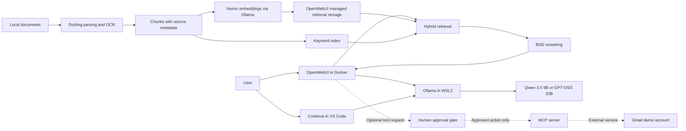

# Local RAG & Agent Platform

A privacy-focused, GPU-accelerated AI workspace powered by OpenWebUI, Ollama, hybrid retrieval, reranking, and permission-gated MCP tools.

## Watch the demos

| [Document Q&A with source verification](https://raw.githubusercontent.com/temii70/LocalRagAgent/main/01-document-qa.mp4) | [Local coding with GPT-OSS](https://raw.githubusercontent.com/temii70/LocalRagAgent/main/assets/demo/02-local-coding-web.mp4) |
| --- | --- |
| [](https://raw.githubusercontent.com/temii70/LocalRagAgent/main/01-document-qa.mp4) | [](https://raw.githubusercontent.com/temii70/LocalRagAgent/main/assets/demo/02-local-coding-web.mp4) |
| Qwen answers questions from the Demo Workspace documents with source citations. | Continue proposes a fix to a recall calculation using GPT-OSS. |

These are looping GIF previews. Click a preview to open or download the full-resolution MP4. Recordings are edited for brevity.

I built the integration, model configuration, retrieval evaluation, and approval-based workflows around an existing local AI stack. It brings document Q&A, coding assistance, and reviewed tool actions onto a Windows 11 workstation with WSL2 and a single RTX 4080 Super.

**Reported use:** more than 100 lecture/research documents tested; top-5 retrieval recall improved from **64% to 86%** after hybrid retrieval and reranking; more than 200 outreach/follow-up emails assisted through a user-approved Gmail workflow. These are owner-reported observations. The private corpus, original relevance labels, and run logs are not included, so this repository does not independently verify those figures.

This repository contains deployment configuration, setup notes, and a synthetic evaluation example. The language models, document parser, retrieval implementation, and storage engine come from the credited upstream projects.

## What it does

- Keeps inference and configured document processing on local hardware, reducing the need to send document text to hosted inference services.
- Uses a smaller model for routine work and a larger model for reasoning and debugging.
- Combines semantic search with keyword search, then reranks candidate passages before answering with source context.
- Connects VS Code through Continue and describes an approval gate for external tool actions.
- Provides sanitized configuration and a runnable retrieval scoring example without private documents or credentials.

Start with the [Windows/WSL setup](docs/setup-windows-wsl.md), [architecture](docs/architecture.md), or [evaluation notes](docs/evaluation.md).

## Architecture



The diagram describes the full workspace. The supplied Compose file starts OpenWebUI only; RAG needs the [additional configuration](docs/setup-windows-wsl.md#configure-document-retrieval). The Gmail integration is a documented private workflow, with no executable connector or approval gate shipped here.

## Technology stack

| Component | Role |
| --- | --- |
| Windows 11, WSL2, Docker Desktop | Host, Linux runtime, browser UI container |
| OpenWebUI | Chat, document ingestion, retrieval integration, persistent state |
| Ollama | Local model serving and model aliases |
| Qwen 3.5 9B / GPT-OSS 20B | Generation and tool-call proposals |
| Docling | Document parsing and OCR; existing setup described as "v4" (exact release unrecorded) |
| Nomic / BGE | Embeddings / reranking |
| Continue.dev | Local coding assistance in VS Code |
| Model Context Protocol (MCP) | Optional tool integration with explicit action approval |

## Two models, one GPU

| Alias | Base model | Configured context | Intended use |
| --- | --- | --- | --- |
| `qwen3.5-32k` | `qwen3.5:9b` | 32,768 tokens | Faster chat, document Q&A, routine coding |
| `gpt-oss-16k` | `gpt-oss:20b` | 16,384 tokens | Reasoning, debugging, harder edits |

These are workflow choices, not published speed or quality benchmarks. Both aliases and context settings were confirmed on the existing WSL Ollama installation. Clients can override context settings; keep OpenWebUI and Continue aligned with the Modelfiles.

The installed quantized base models occupy roughly 6.6 GB and 13 GB on disk. Disk size is **not** peak VRAM use: context caches, runtime buffers, embeddings, and OCR also need resources. Run one generation model at a time, limit concurrent requests, and check `ollama ps` and `nvidia-smi`. Reduce context if needed; full GPU residency at the configured maximum is not guaranteed. See [memory planning](docs/architecture.md#memory-and-model-lifecycle) and the [Ollama FAQ](https://docs.ollama.com/faq).

## RAG pipeline

Retrieval-augmented generation (RAG) supplies relevant source passages to a model at question time.

1. Parse local documents with Docling, using OCR for scanned pages.
2. Split the extracted text into chunks and retain document/page metadata.
3. Create Nomic embeddings: numerical representations used for semantic matching.
4. Combine semantic matches with keyword matches in hybrid retrieval.
5. Use BGE to score query/passage pairs again and select the best context.
6. Ask the selected local model to answer using that context; inspect cited passages.

OpenWebUI supplies the retrieval and storage integration. [Upstream RAG documentation](https://docs.openwebui.com/features/chat-conversations/rag/) explains its behavior; this project does not implement a custom vector database.

## Retrieval evaluation

| Configuration | Reported top-5 recall |
| --- | ---: |
| Original baseline; exact settings unavailable | 64% |
| Hybrid retrieval + BGE reranking | 86% |

That is a reported **22 percentage-point** improvement. Recall asks how many labeled relevant documents appeared in the retrieved set. It does not measure answer correctness. The original query count, aggregation method, and baseline settings are unrecorded here; the figures are not reproducible from the public examples.

The [evaluation protocol](docs/evaluation.md) defines an explicit document-level metric for new runs. [Synthetic queries](evaluation/example_queries.json), [illustrative rankings](evaluation/predictions.example.json), and a [standard-library scorer](evaluation/score.py) demonstrate the format:

```powershell
python evaluation/score.py --queries evaluation/example_queries.json --predictions evaluation/predictions.example.json --output evaluation/runs/example.csv
```

This scores supplied rankings; it does not run retrieval or recreate the reported experiment. See [evaluation instructions](evaluation/README.md).

## Hardware

The reference system uses an NVIDIA RTX 4080 Super with 16 GB VRAM. A practical starting recommendation is 32 GB system RAM and 50 GB free SSD space for models, container images, caches, and small datasets; these are planning estimates rather than measured minimums. CPU fallback or smaller models can work on other hardware, with different performance.

## Quick start

1. Install WSL2 with Ubuntu, the Windows NVIDIA driver with WSL CUDA support, and Docker Desktop with its WSL2 backend. Use the [setup guide](docs/setup-windows-wsl.md) for commands and networking checks.
2. Install Ollama **inside WSL**, then run the following in a WSL terminal at the repository root:

```bash
ollama pull qwen3.5:9b
ollama pull gpt-oss:20b
ollama pull nomic-embed-text
ollama create qwen3.5-32k -f ollama/Modelfile.qwen3.5-32k
ollama create gpt-oss-16k -f ollama/Modelfile.gpt-oss-16k
ollama show qwen3.5-32k --parameters
ollama show gpt-oss-16k --parameters
```

3. In PowerShell at the repository root, copy `.env.example` to `.env`. Set `WEBUI_SECRET_KEY` to a private random value using the [PowerShell generation steps](docs/setup-windows-wsl.md#start-openwebui). No secret is provided in this repository.
4. Review `OPENWEBUI_IMAGE`: `main` is a documented, mutable fallback because no stable release tag was recorded. Select and record a tested upstream release tag or image digest before relying on repeatable deployments.

```powershell
docker compose config --quiet
docker compose up -d
```

5. Open [localhost:3000](http://localhost:3000), create the initial administrator account, and verify sign-up is disabled afterward. Confirm the Ollama connection resolves to the WSL server and both aliases appear.
6. Follow [RAG setup](docs/setup-windows-wsl.md#configure-document-retrieval) to select Nomic, hybrid search, BGE, and optional Docling. Upload only the supplied synthetic corpus for a public demo.

The named volume persists accounts, chats, uploads, and indexes. Authentication stays enabled, and the published port binds to loopback. No existing containers need to be replaced to inspect this configuration.

## Continue in VS Code

Install Continue and open its local YAML configuration. Merge the models from [continue.example.yaml](config/continue.example.yaml). Both entries use `provider: ollama`, roles `chat`, `edit`, `apply`, and `capabilities: [tool_use]`. Set `apiBase` to the same reachable WSL server used by OpenWebUI, taking the VS Code extension's execution environment into account.

The declaration enables tool support in the client; it does not grant permissions or guarantee every tool call succeeds. See [Continue's configuration reference](https://docs.continue.dev/reference).

## Security and privacy

Local inference reduces external data transfer. Model downloads, extensions, optional cloud features, and Gmail can still create network traffic. Local processing does not automatically provide regulatory compliance. This is not a clinical decision system, and no HIPAA compliance claim is made.

The private Gmail workflow requires a person to inspect and approve each proposed action before execution. More than 200 assisted emails is an owner-reported usage count, not autonomous sends or a success rate. The public configuration contains no Gmail connector, OAuth files, or MCP credentials. [Security notes](docs/security-and-privacy.md) describe the intended enforcement boundary and demo requirements.

Use synthetic or appropriately licensed public documents and a separate demo account. Do not expose port 3000 publicly without authentication and appropriate network controls.

## Screenshots

The two demo videos and their clickable previews are at the top of this README.

Screenshot placeholders and capture guidance live in [assets/README.md](assets/README.md). Add `workspace-overview.png`, `rag-citations.png`, `continue-local-models.png`, `tool-approval.png`, and `gpu-memory.png` after redacting account data and private content. No screenshots or benchmark graphics are fabricated here.

## Limitations

- Original evaluation evidence and exact historical retrieval settings are private or unavailable.
- OCR, retrieval, citations, and generated answers can be wrong; source verification remains necessary.
- A 16 GB GPU limits context, concurrency, and simultaneous model residency.
- The full RAG configuration needs manual setup; the minimal Compose file starts the UI only.
- Docling "v4" is not a verified package pin. Upstream versions and UI settings can change.
- MCP/Gmail orchestration is documented but excluded from the public runtime.

## Roadmap

- Publish a larger synthetic corpus with recorded relevance judgments and real retrieval exports.
- Record tested image digests, Docling versions, chunking settings, and retrieval configuration.
- Benchmark latency, memory, OCR quality, and model switching with fixed inputs.
- Package a credential-free mock MCP server with enforceable approvals and audit records.

## Credits and license

Built on [OpenWebUI](https://github.com/open-webui/open-webui), [Ollama](https://github.com/ollama/ollama), [Docling](https://github.com/docling-project/docling), [Qwen](https://github.com/QwenLM/Qwen3.5), [GPT-OSS](https://github.com/openai/gpt-oss), [Nomic embeddings](https://ollama.com/library/nomic-embed-text), [BGE / FlagEmbedding](https://github.com/FlagOpen/FlagEmbedding), [Continue](https://github.com/continuedev/continue), and [MCP](https://modelcontextprotocol.io/). Their authors provide the underlying models and software.

Repository-authored configuration, documentation, and evaluation utilities use the existing [Apache License 2.0](LICENSE). Third-party projects and model weights retain their own licenses and notices; this repository does not redistribute their source code or weights.
