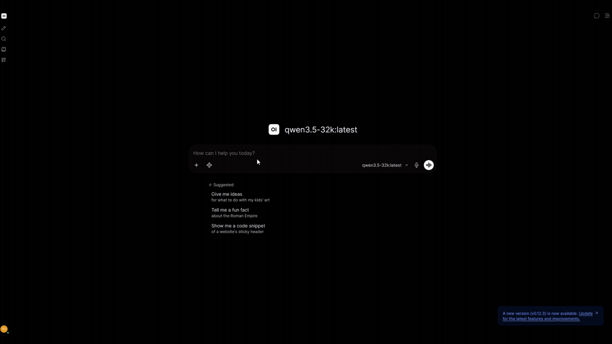
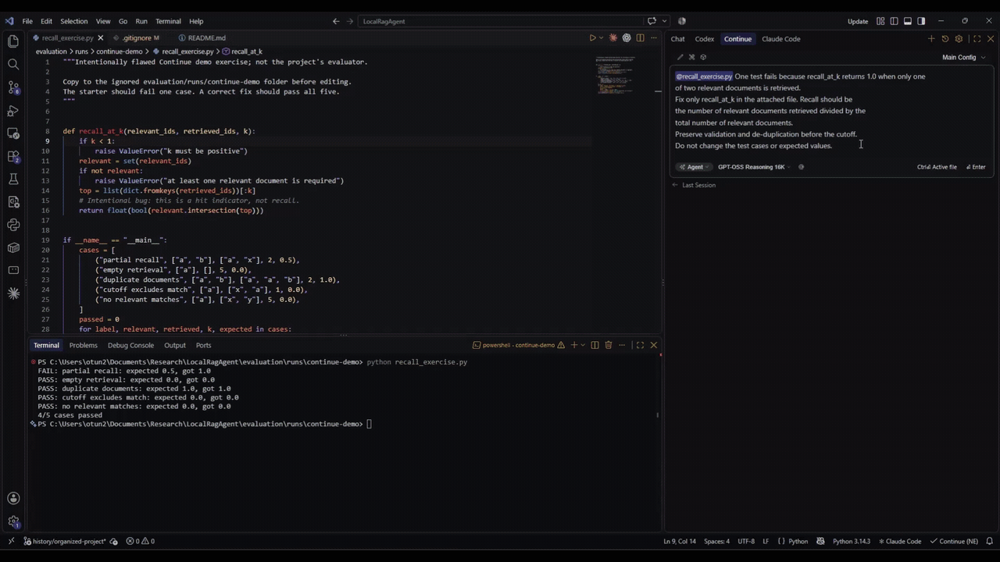
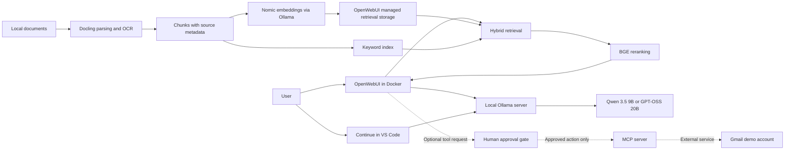

# Local RAG & Agent Platform

A privacy-focused, GPU-accelerated AI workspace powered by OpenWebUI, Ollama, hybrid retrieval, reranking, and permission-gated MCP tools.

## Demos

### Document Q&A with source verification

Qwen answers questions from the Demo Workspace documents with source citations.

[](https://raw.githubusercontent.com/temii70/LocalRagAgent/main/assets/demo/document-qa.gif)

[Open full-size animation](https://raw.githubusercontent.com/temii70/LocalRagAgent/main/assets/demo/document-qa.gif) | [Full-resolution MP4](https://raw.githubusercontent.com/temii70/LocalRagAgent/main/assets/demo/01-document-qa.mp4)

### Local coding with GPT-OSS

Continue proposes a fix to a recall calculation using GPT-OSS.

[](https://raw.githubusercontent.com/temii70/LocalRagAgent/main/assets/demo/local-coding.gif)

[Open full-size animation](https://raw.githubusercontent.com/temii70/LocalRagAgent/main/assets/demo/local-coding.gif) | [Full-resolution MP4](https://raw.githubusercontent.com/temii70/LocalRagAgent/main/assets/demo/02-local-coding-web.mp4)

Recordings are edited for brevity. Full-size animations and MP4 recordings are linked above.

## Overview

I built this workspace to work with local documents, get coding assistance in VS Code, and review tool actions before execution. It runs on a Windows 11 workstation with WSL2 and an RTX 4080 Super with 16 GB VRAM.

My work covers the integration, model configuration, retrieval evaluation, and approval-based workflows. OpenWebUI, Ollama, Docling, and the other upstream projects provide the models, parsing, retrieval, and storage components.

The public repository includes deployment configuration, setup documentation, a synthetic document corpus, and an offline retrieval scorer. Private documents and the Gmail connector are excluded.

## What it does

- **Local inference:** document Q&A and coding assistance without sending prompts to a hosted inference provider.
- **Two-model workflow:** Qwen for routine work; GPT-OSS for reasoning and debugging.
- **Document retrieval:** semantic and keyword search with BGE reranking and source references.
- **Editor integration:** Continue connects VS Code to the local model server.
- **Evaluation:** synthetic relevance labels, example rankings, and a document-level recall scorer.

[Setup](docs/setup-windows-wsl.md) | [Architecture](docs/architecture.md) | [Evaluation](docs/evaluation.md) | [Security](docs/security-and-privacy.md)

## Architecture



The diagram covers the full workspace. Compose starts OpenWebUI; Ollama and optional Docling services run separately. Retrieval settings are documented in the [setup guide](docs/setup-windows-wsl.md#configure-document-retrieval). The MCP/Gmail path represents a separate private integration; its connector and approval gate are not part of the public runtime.

Ollama can run on Windows or in WSL2. Each installation has its own model store, so chat and embedding endpoints must point to the intended instance. The setup guide uses WSL2 as the reference deployment.

## Technology stack

| Component | Role |
| --- | --- |
| Windows 11, WSL2, Docker Desktop | Host, Linux runtime, browser UI container |
| OpenWebUI | Chat, document ingestion, retrieval integration, persistent state |
| Ollama | Local model serving and model aliases |
| Qwen 3.5 9B / GPT-OSS 20B | Generation and tool-call proposals |
| Docling | Document parsing and OCR |
| Nomic / BGE | Embeddings / reranking |
| Continue.dev | Local coding assistance in VS Code |
| Model Context Protocol (MCP) | Optional tool integration with explicit action approval |

## Two models, one GPU

| Alias | Base model | Configured context | Intended use |
| --- | --- | --- | --- |
| `qwen3.5-32k` | `qwen3.5:9b` | 32,768 tokens | Faster chat, document Q&A, routine coding |
| `gpt-oss-16k` | `gpt-oss:20b` | 16,384 tokens | Reasoning, debugging, harder edits |

The aliases configure context windows on existing models; they do not retrain them. Both settings were checked against the local Ollama installation. Client-level context settings can override the Modelfiles. The intended uses above describe the workflow, rather than a model benchmark.

The quantized base models occupy roughly 6.6 GB and 13 GB on disk. Runtime memory also includes context caches and buffers, so those sizes are not peak VRAM measurements. The 16 GB GPU budget favors one active generation model and limited concurrency; larger contexts may require CPU offload. [Memory planning](docs/architecture.md#memory-and-model-lifecycle) covers model switching and inspection with `ollama ps` and `nvidia-smi`.

## RAG pipeline

Retrieval-augmented generation (RAG) supplies relevant source passages to a model at question time.

1. **Extraction:** Docling parses documents and uses OCR for scanned pages.
2. **Chunking:** extracted text is split into passages with source metadata.
3. **Embedding:** Nomic represents passages numerically for semantic search.
4. **Hybrid retrieval:** semantic matches are combined with keyword matches.
5. **Reranking:** BGE scores the candidate passages against the question.
6. **Generation:** the selected local model receives the question and retrieved context, then produces an answer with source references.

OpenWebUI supplies the retrieval and storage integration. The [upstream RAG documentation](https://docs.openwebui.com/features/chat-conversations/rag/) describes its implementation. Retrieval augments the prompt at question time; it does not train the model on the documents.

## Retrieval evaluation

The system has been tested on more than 100 lecture/research documents. Reported local results:

| Configuration | Top-5 recall |
| --- | ---: |
| Original baseline | 64% |
| Hybrid retrieval + BGE reranking | 86% |

The reported improvement is **22 percentage points**. Recall measures the fraction of labeled relevant documents found in the retrieved set, separately from answer correctness.

The original corpus, query set, relevance labels, run logs, and exact baseline configuration are not published. The historical scoring details are incomplete, so these figures cannot be reproduced from the public example. The [evaluation notes](docs/evaluation.md) document those limits and define a protocol for new runs.

The public example includes [synthetic queries](evaluation/example_queries.json), [illustrative rankings](evaluation/predictions.example.json), and a [Python standard-library scorer](evaluation/score.py):

```powershell
python evaluation/score.py --queries evaluation/example_queries.json --predictions evaluation/predictions.example.json --output evaluation/runs/example.csv
```

This command scores supplied rankings. The example rankings are handwritten and labeled `illustrative`; they are separate from the reported private experiment. Schema and scoring details are in [evaluation/README.md](evaluation/README.md).

## Hardware

| Resource | Reference or planning target |
| --- | --- |
| GPU | NVIDIA RTX 4080 Super, 16 GB VRAM |
| Operating system | Windows 11 with WSL2 |
| System RAM | 32 GB recommended for planning |
| Free SSD space | About 50 GB for models, images, caches, and a small corpus |

RAM and disk figures are estimates, not measured minimum requirements. Smaller models and CPU offload allow other hardware configurations with different performance.

## Quick start

Prerequisites: WSL2 with Ubuntu, a Windows NVIDIA driver with WSL CUDA support, Docker Desktop using the WSL2 backend, and Ollama installed inside WSL. Installation and networking details are in the [setup guide](docs/setup-windows-wsl.md).

**Models** — in a WSL terminal at the repository root:

```bash
ollama pull qwen3.5:9b
ollama pull gpt-oss:20b
ollama pull nomic-embed-text
ollama create qwen3.5-32k -f ollama/Modelfile.qwen3.5-32k
ollama create gpt-oss-16k -f ollama/Modelfile.gpt-oss-16k
ollama show qwen3.5-32k --parameters
ollama show gpt-oss-16k --parameters
```

**OpenWebUI** — `.env.example` provides the environment template. A private `.env` requires a random `WEBUI_SECRET_KEY`; [PowerShell setup steps](docs/setup-windows-wsl.md#start-openwebui) generate it without overwriting an existing configuration.

`OPENWEBUI_IMAGE` defaults to the mutable `main` tag. A tested release tag or digest is needed for a repeatable deployment; this repository does not yet pin one.

From PowerShell at the repository root, after configuring `.env`:

```powershell
docker compose config --quiet
docker compose up -d
```

The interface is available at [localhost:3000](http://localhost:3000). Initial setup creates an administrator account; authentication remains enabled and new sign-ups should be disabled after setup. The Ollama connection must resolve to the instance containing the model aliases.

Nomic embeddings, hybrid search, BGE reranking, and optional Docling extraction require the [RAG configuration](docs/setup-windows-wsl.md#configure-document-retrieval). The [synthetic corpus](evaluation/corpus/) provides the documents used in the demo.

The named Docker volume persists accounts, chats, uploads, and indexes. The UI port binds to loopback.

## Continue in VS Code

The [Continue configuration example](config/continue.example.yaml) defines both aliases with `provider: ollama`, roles `chat`, `edit`, `apply`, and `capabilities: [tool_use]`.

These entries belong in Continue's active local YAML configuration. `apiBase` identifies the model server reachable from the VS Code extension's execution environment. Tool capability is separate from permission to execute an action. Field definitions are in [Continue's configuration reference](https://docs.continue.dev/reference).

## Security and privacy

Local inference reduces the need to send prompts and document text to hosted model providers. Downloads, extensions, optional cloud features, and external tools can still generate network traffic. Local processing does not establish regulatory compliance; this project is not a clinical decision system and makes no HIPAA compliance claim.

The separate Gmail workflow requires human review of proposed actions before execution. Its reported usage is more than 200 assisted outreach/follow-up emails. That count describes assisted messages, not autonomous sends or a measured success rate. The connector, OAuth files, and MCP credentials are excluded from the public runtime.

MCP defines tool communication; approval must be enforced by the client or executor. The supplied configuration keeps OpenWebUI authenticated and bound to localhost. Public access requires appropriate authentication and network controls. Public demos use synthetic or appropriately licensed documents and a separate account. Further details are in [security and privacy](docs/security-and-privacy.md).

## Limitations

- Private evaluation evidence and incomplete historical settings limit reproducibility of the reported results.
- OCR errors, missed passages, and unsupported generated claims still require source review.
- A 16 GB GPU limits context size, concurrency, and simultaneous model residency.
- Compose starts the UI; the full retrieval pipeline needs additional configuration.
- OpenWebUI and Docling versions are not pinned, so configuration and API compatibility can change.
- The private MCP/Gmail connector and approval implementation are not included.

## Roadmap

- Publish a larger synthetic corpus with recorded relevance judgments and real retrieval exports.
- Record tested image digests, Docling versions, chunking settings, and retrieval configuration.
- Benchmark latency, memory, OCR quality, and model switching with fixed inputs.
- Package a credential-free mock MCP server with enforceable approvals and audit records.

## Credits and license

Built with [OpenWebUI](https://github.com/open-webui/open-webui), [Ollama](https://github.com/ollama/ollama), [Docling](https://github.com/docling-project/docling), [Qwen](https://github.com/QwenLM/Qwen3.5), [GPT-OSS](https://github.com/openai/gpt-oss), [Nomic embeddings](https://ollama.com/library/nomic-embed-text), [BGE / FlagEmbedding](https://github.com/FlagOpen/FlagEmbedding), [Continue](https://github.com/continuedev/continue), and [MCP](https://modelcontextprotocol.io/).

Original configuration, documentation, and evaluation utilities are covered by [Apache License 2.0](LICENSE). Upstream software and model weights retain their respective licenses and notices. Their source code and weights are not redistributed here.
