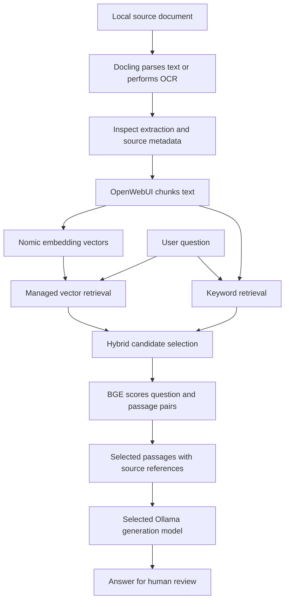

# Architecture and engineering scope

[Repository overview](../README.md) | [Setup](setup-windows-wsl.md) | [Security](security-and-privacy.md)

The workspace integrates existing tools for local document Q&A, coding assistance, and reviewed external actions. The work represented here is integration, configuration, workflow design, and evaluation. Model training, OCR algorithms, retrieval primitives, and database internals belong to the upstream projects.

## Runtime boundaries

| Boundary | Runs here | Data handled |
| --- | --- | --- |
| Windows 11 | Browser, Docker Desktop, optional VS Code client | User interaction and container management |
| WSL2 Ubuntu | Ollama, local model weights | Prompts, generation, Nomic embeddings |
| OpenWebUI container | UI backend, ingestion/retrieval integration, CPU reranking where supported | Chats, document chunks, source metadata |
| Optional Docling service | Host/container selected during setup | Original files, parsed text, OCR output |
| Private MCP server | Separately configured tool runtime | Approved requests and external-service credentials |

OpenWebUI's named Docker volume holds its application state, including private content after ingestion. It is not encryption, an access-control boundary against the host administrator, or a public artifact.

The minimal [Compose file](../docker-compose.yml) contains only OpenWebUI. Ollama stays in WSL, and Docling and MCP are separate integrations. GPU access belongs to Ollama; the UI container does not need a GPU device mapping for basic chat.

## Ingestion and retrieval

Semantic retrieval finds related meaning, including paraphrases. Keyword retrieval preserves exact names, identifiers, and terminology. Hybrid retrieval combines those signals; reranking reorders the candidates by relevance to the question. OpenWebUI supplies these mechanisms; exact fusion and scoring behavior depend on its version and configuration. See the [upstream RAG guide](https://docs.openwebui.com/features/chat-conversations/rag/).

Retain document IDs and page/section metadata when available. Broken extraction, missing page references, and oversized chunks can undermine retrieval even when the model is capable. Review a few extracted pages before indexing a corpus. Rebuild embeddings when changing the embedding model; do not compare vectors from different embedding spaces.

The existing stack is described as "Docling v4." No exact package/container version was found during preparation. `docling`, `docling-serve`, and the `dlparse_v4` PDF backend are distinct versioned components. This repository does not assume that label establishes a specific release or parser backend.

## Memory and model lifecycle

The aliases set operating context windows, not a guarantee of available memory. A context window is the token budget shared by instructions, history, retrieved passages, and output. Large retrieval payloads can leave little room for an answer.

The observed base-model files were about 6.6 GB for Qwen (Q4_K_M) and 13 GB for GPT-OSS (MXFP4). These are on-disk sizes from `ollama list`, not memory measurements. Quantization compresses weights; KV caches and runtime allocations still consume memory. CPU offload may occur.

For a 16 GB card, use one generation model at a time and one parallel request as a starting point. `OLLAMA_MAX_LOADED_MODELS=1` and `OLLAMA_NUM_PARALLEL=1` are suggested server settings, not changes applied by Compose. Nomic embedding requests may evict the active generator under this policy. Batch ingestion before interactive work where possible, and let small preprocessing components run on CPU unless GPU headroom has been measured.

Switching models can incur load time. Inspect `ollama ps` for the actual CPU/GPU split and context; inspect `nvidia-smi` while requests run. Lower context before assuming an out-of-memory issue requires different hardware. Ollama documents [memory and concurrency behavior](https://docs.ollama.com/faq).

## Tool execution boundary

The intended flow is: request, model proposal, exact-argument preview, human approval, authorized server execution, result. Approval must bind the tool name, account, destination, and arguments. A changed proposal requires fresh approval. A prompt asking a model to seek permission is not an execution gate.

The private Gmail workflow follows an approval-based operating process; its enforcement implementation was not inspected or included here. The public runtime exposes no Gmail tool. [Security notes](security-and-privacy.md#approval-gated-tools) specify what a public implementation would need before enabling external actions.

## Reproduction boundary

The [setup guide](setup-windows-wsl.md) reproduces local chat and explains manual RAG configuration. The [evaluation folder](../evaluation/README.md) reproduces the public scoring format. It cannot reproduce the original private corpus or historical 64%/86% result. No service, credential, or saved private database is bundled.

## Public mock MCP execution

The [mock mail server](../mock_mcp/README.md) exposes four stdio tools using the official MCP SDK. A proposal stores exact arguments and their digest. A separate interactive terminal reviewer approves or denies it; no approval tool is exposed to the model. Execution checks the digest, expiry, and approval state inside a SQLite write transaction, then records a synthetic outbox entry, consumes approval, and appends an audit event atomically. There is no external mail transport. The local OS account remains trusted.
